# Decisiones metodológicas y puntos de control

Este documento resume las principales dudas metodológicas que surgieron durante el desarrollo del flujo y la decisión adoptada en cada caso.

## Diagrama de decisiones

```mermaid
flowchart TD

    %% =========================
    %% DISEÑO EXPERIMENTAL
    %% =========================
    A[Diseño experimental<br/>30 plantas MD2] --> A1[Siembra<br/>16-oct-2025]
    A1 --> A2[Material: hijo basal<br/>≈300 g por planta]
    A2 --> A3[Ingreso a ambiente controlado<br/>14-may-2026<br/>210 DDS]

    A3 --> L1[Iluminación artificial<br/>Spider Farmer SF-G4500]
    L1 --> L2[2 luminarias<br/>60 % potencia]
    L2 --> L3[Fotoperiodo variable<br/>simulación semanas 47–9]
    L3 --> L4[PPFD medido<br/>pendiente de incorporación]
    L4 --> L5[DLI / caracterización lumínica<br/>pendiente de consolidación]

    %% =========================
    %% SESIONES TEMPORALES
    %% =========================
    A3 --> B[Sesiones fotográficas registradas en bitácora]

    B --> B1[28-may-2026<br/>224 DDS]
    B --> B2[10-jul-2026<br/>267 DDS]
    B --> B3[21-ago-2026<br/>309 DDS]

    B --> C{¿Fecha EXIF confiable?}
    C -- No --> C1[Usar fechas de bitácora]
    C1 --> C2[Asignar capturas mediante<br/>fuente, carpeta, secuencia y continuidad]

    %% =========================
    %% ORGANIZACIÓN DEL DATASET
    %% =========================
    C2 --> D[Inventario de TIFF]
    D --> D1[Identificar GRE / RED / REG / NIR]
    D1 --> D2[SHA-256 y detección de duplicados]
    D2 --> D3[Capturas completas por sesión]

    %% =========================
    %% POSICIÓN / ORIENTACIÓN
    %% =========================
    D3 --> E{¿GPS XY válido?}

    E -- No --> E1[Reconstrucción SfM<br/>en sistema local]
    E -- No --> E2[Auditoría IMU<br/>Yaw / Pitch / Roll]

    E2 --> E3[Comparar IMU con orientación SfM]
    E3 --> E4[Uso diagnóstico de orientación<br/>NO georreferenciación]

    %% =========================
    %% ESCALA MÉTRICA
    %% =========================
    E1 --> F[Medición física del contenedor<br/>22-may-2026]
    F --> F1[Dimensiones<br/>5.80 m × 2.25 m]
    F1 --> F2[Crear marcadores<br/>CONT_A / B / C / D]
    F2 --> F3[Planta 1 → CONT_D<br/>Planta 29 → CONT_B]
    F3 --> F4[Crear barras de escala]
    F4 --> F5[Optimizar cámaras]
    F5 --> F6[Modelo SfM escalado]

    %% =========================
    %% CALIBRACIÓN RADIOMÉTRICA
    %% =========================
    F6 --> G[Calibración radiométrica]
    G --> G1[Panel Batch 4001]
    G1 --> G2[Green 0.189<br/>Red 0.197<br/>Red Edge 0.221<br/>NIR 0.255]
    G2 --> G3[Calibrate Reflectance]
    G3 --> G4[Ortomosaico multibanda<br/>B1 Green / B2 Red / B3 Red Edge / B4 NIR]

    %% =========================
    %% UNIDAD DE ANÁLISIS
    %% =========================
    G4 --> H[Delimitación del dosel]

    H --> H1[Unidad actual:<br/>dosel completo de 30 plantas]
    H1 --> H2[Pesos y posiciones individuales<br/>se conservan como información auxiliar]

    %% =========================
    %% VARIABLES ESPECTRALES
    %% =========================
    H1 --> I[NIR + índices espectrales]
    I --> I1[NIR]
    I --> I2[NDVI]
    I --> I3[GNDVI]
    I --> I4[EVI2<br/>pendiente de estandarización]
    I --> I5{¿Red Edge consistente?}

    I5 -- No --> I6[Excluir NDRE<br/>del análisis principal]
    I5 -- Sí --> I7[Evaluar NDRE]

    %% =========================
    %% CONTROL ENTRE SESIONES
    %% =========================
    I1 --> J
    I2 --> J
    I3 --> J
    I4 --> J
    I6 --> J
    I7 --> J

    J{¿Flujo completo validado<br/>en las 3 sesiones?}

    J -- No --> J1[Estado actual:<br/>solo 21-ago-2026 validada]
    J1 --> J2[Procesar y validar<br/>28-may y 10-jul]
    J2 --> J

    %% =========================
    %% ANÁLISIS TEMPORAL
    %% =========================
    J -- Sí --> K[Armonización temporal]
    K --> K1[Comparar valores absolutos]
    K --> K2[Comparar cambio respecto a 28-may]
    K1 --> K3[Relacionar respuesta con<br/>fotoperiodo + edad + tiempo en ambiente controlado]
    K2 --> K3

    %% =========================
    %% ML FUTURO
    %% =========================
    K3 --> M{¿Existen suficientes<br/>unidades analíticas?}

    M -- No --> M1[No entrenar ML formal<br/>con 3 observaciones de dosel]
    M1 --> M2[Evaluar segmentación futura]

    M2 --> M3[Planta individual]
    M2 --> M4[Subzonas del dosel]
    M2 --> M5[Teselas espaciales]

    M3 --> N[Propuesta futura de ML]
    M4 --> N
    M5 --> N

    N --> N1[Predictores:<br/>NIR / NDVI / GNDVI / fotoperiodo / edad / peso]
    N1 --> N2[Definir variable objetivo independiente<br/>p. ej. estrés o severidad]
```

## Registro de decisiones

| Duda metodológica | Evidencia observada | Decisión adoptada | Consecuencia | Estado |
|---|---|---|---|---|
| Fechas internas no confiables | Reinicios del reloj y fechas incorrectas | Usar bitácora como referencia temporal | Las sesiones son 2026-05-28, 2026-07-10 y 2026-08-21 | **Validado** |
| Ausencia de GPS XY | `GPSStatus = Measurement Void` | Trabajar en coordenadas locales | No hay georreferenciación absoluta | **Validado** |
| Escala física del modelo | Contenedor medido el 22-05-2026 | Marcadores + barras de escala | El modelo obtiene escala métrica | **Validado para 21-ago-2026** |
| Uso de IMU | Yaw/Pitch/Roll disponibles | Auditoría y comparación con SfM | Diagnóstico de orientación, no posición | **Experimental** |
| CONT_C no es una esquina exacta | Punto físico parcialmente visible | Usarlo como referencia aproximada | Sus errores no son una validación métrica estricta | **Documentado** |
| Iluminación | Spider Farmer SF-G4500, 60 % de potencia y fotoperiodo variable | Tratar fotoperiodo como factor principal | La interpretación se centra en horas luz, edad y tiempo en ambiente controlado | **Implementado; PPFD pendiente de incorporar** |
| Panel de reflectancia | Batch 4001 disponible | Calibración por banda | Permite análisis espectral trazable | **Implementado para 21-ago-2026** |
| NDVI | Respuesta espacial coherente | Mantenerlo como índice principal | Base para comparación temporal | **Funcional para 21-ago-2026** |
| GNDVI | Usa Green y NIR, sin depender de Red Edge | Mantenerlo como índice complementario | Puede apoyar análisis fisiológico | **Disponible** |
| EVI2 | No requiere banda azul | Incorporarlo tras estandarizar el cálculo | Índice complementario futuro | **Pendiente** |
| NDRE negativo | NIR < Red Edge en gran parte del mosaico | Excluir NDRE por ahora | Evita forzar una interpretación incorrecta | **En revisión radiométrica** |
| Unidad de análisis | 30 plantas con pesos y posiciones conocidas | Usar el dosel completo como unidad actual | Simplifica y evita errores de segmentación prematura | **Definido** |
| Validación entre fechas | Solo 2026-08-21 completada | Replicar mayo y julio | No hay todavía comparación temporal validada | **Pendiente para 28-may y 10-jul** |
| Armonización temporal | Tres fechas con respuesta espectral por comparar | Conservar valores absolutos y cambios respecto a 28-may | Preserva señal temporal y evita normalización excesiva | **Propuesta metodológica** |
| ML | Solo tres observaciones si se usa el dosel completo | No entrenar ML formal todavía | Primero validar tres sesiones y aumentar unidades analíticas | **Futuro** |

## Principio general

Cuando una fuente de información no es confiable o está ausente, el flujo no intenta reconstruirla artificialmente. Se documenta la limitación y se utiliza la fuente independiente más apropiada disponible, manteniendo separadas las funciones de tiempo, posición, orientación, escala y reflectancia.

## Decisión sobre caracterización lumínica

### Duda metodológica

El experimento se desarrolló con iluminación artificial mediante lámparas Spider Farmer, mientras que el factor experimental principal correspondió a cambios en la duración diaria de luz.

Era necesario diferenciar entre potencia o intensidad de las lámparas, cantidad de fotones recibidos por el dosel y duración diaria del periodo luminoso.

### Decisión

La duración de luz se considera el factor experimental principal.

La intensidad de operación de las lámparas se mantuvo estable y las plantas fueron sometidas a una simulación del horario semanal de luz correspondiente a las semanas 47–9.

La caracterización física de la iluminación debe expresarse mediante **PPFD** a nivel del dosel y, cuando corresponda, mediante **DLI** calculado a partir de PPFD y fotoperiodo.

### Estado

Los datos medidos de PPFD se encuentran pendientes de incorporación al repositorio.

Hasta su incorporación, la documentación debe distinguir claramente entre:

- configuración nominal de las lámparas;
- fotoperiodo programado;
- medición fotónica real recibida por el dosel.

## Decisión sobre la unidad de análisis

### Duda metodológica

El arreglo experimental contiene 30 plantas con pesos diferentes y posiciones conocidas dentro del contenedor.

Era posible considerar cada planta individual, grupos de plantas según peso, zonas espaciales del contenedor o el dosel completo como unidad.

### Decisión actual

Para la primera etapa del análisis se utiliza el **dosel completo de las 30 plantas como unidad de análisis**.

La decisión se tomó para reducir complejidad de segmentación y evitar introducir errores adicionales de delimitación individual antes de validar completamente el procesamiento multiespectral.

La posición y el peso individual se conservan para una futura etapa de segmentación por planta, rango de peso o sector.

## Fundamento bibliográfico de los índices

La selección de NIR, NDVI, GNDVI, EVI2 y la evaluación inicial de NDRE no se definió únicamente a partir del comportamiento del ortomosaico. También se apoyó en literatura de revisión sobre fisiología vegetal, estrés y respuesta de índices multiespectrales.

- **Pérez-Chimal et al. (2026)** respaldan el uso de NDVI como indicador ampliamente utilizado de vigor, biomasa y estructura del dosel y documentan la relevancia de NDRE, GNDVI, Red Edge y NIR para clorofila y estrés.
- **Haque et al. (2024)** documentan NDVI, NDRE, GNDVI y EVI entre los índices comunes y advierten sobre saturación de NDVI y sensibilidad de los índices a condiciones de iluminación y calibración.
- **Zandi et al. (2025)** relacionan cambios en NIR y Red Edge con respuestas fisiológicas y de estrés, lo que sustenta el seguimiento de la señal NIR en este experimento.

La decisión metodológica es mantener una separación entre **fundamento bibliográfico** y **validación del dataset**. Un índice puede estar bien respaldado en la literatura y, aun así, ser excluido temporalmente si el control de calidad radiométrico del experimento no es satisfactorio. Este es actualmente el caso de NDRE.
