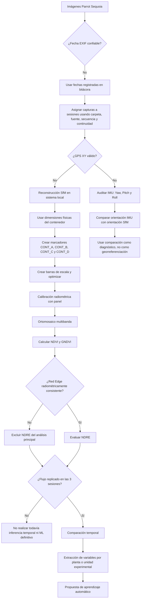

# Decisiones metodológicas y puntos de control

Este documento resume las principales dudas metodológicas que surgieron durante el desarrollo del flujo y la decisión adoptada en cada caso.

## Diagrama de decisiones

## Registro de decisiones

| Duda metodológica | Evidencia observada | Decisión adoptada | Consecuencia |
|---|---|---|---|
| Fechas internas no confiables | Reinicios del reloj y fechas incorrectas | Usar bitácora como referencia temporal | Las sesiones son 2026-05-28, 2026-07-10 y 2026-08-21 |
| Ausencia de GPS XY | `GPSStatus = Measurement Void` | Trabajar en coordenadas locales | No hay georreferenciación absoluta |
| Escala física del modelo | Contenedor medido el 22-05-2026 | Marcadores + barras de escala | El modelo obtiene escala métrica |
| Uso de IMU | Yaw/Pitch/Roll disponibles | Auditoría y comparación con SfM | Diagnóstico de orientación, no posición |
| CONT_C no es una esquina exacta | Punto físico parcialmente visible | Usarlo como referencia aproximada | Sus errores no son una validación métrica estricta |
| Panel de reflectancia | Batch 4001 disponible | Calibración por banda | Permite análisis espectral trazable |
| NDRE negativo | NIR < Red Edge en gran parte del mosaico | Excluir NDRE por ahora | Evita forzar una interpretación incorrecta |
| Validación entre fechas | Solo 2026-08-21 completada | Replicar mayo y julio | No hay todavía comparación temporal validada |
| ML | Variables espectrales aún no armonizadas entre fechas | Posponer entrenamiento | Primero validar las tres sesiones |

## Principio general

Cuando una fuente de información no es confiable o está ausente, el flujo no intenta reconstruirla artificialmente. Se documenta la limitación y se utiliza la fuente independiente más apropiada disponible, manteniendo separadas las funciones de tiempo, posición, orientación, escala y reflectancia.
