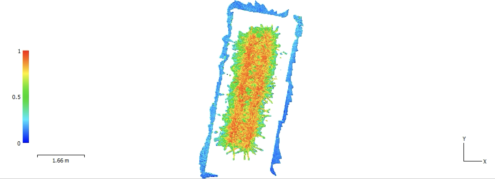

# Flujo general

## 1. Adquisición

Cada disparo Parrot Sequoia puede producir:

- GRE — Green
- RED — Red
- REG — Red Edge
- NIR — Near Infrared
- RGB — imagen RGB de referencia

Para WebODM, el conjunto multiespectral se procesa con GRE + RED + REG + NIR.

## 2. Inventario

El pipeline recorre recursivamente `Interna/` y `SD/`.

Se excluyen:

- `.thumb`
- `Zip_Originales`
- `__MACOSX`
- carpetas de salida del propio pipeline

## 3. Validación de capturas

Una captura multiespectral se considera completa si contiene:

```text
GRE + RED + REG + NIR
```

El RGB no es requisito para considerar completa una captura.

## 4. Duplicados

Se usa SHA-256 para identificar archivos idénticos sin depender de fechas o nombres.

## 5. Reconstrucción de sesiones

Debido a reinicios del reloj de la cámara, la fecha embebida no se trata como verdad experimental.

Las **fechas utilizadas para particionar el conjunto de imágenes en sesiones experimentales corresponden a fechas registradas en la bitácora de campo**. No fueron inferidas a partir de los metadatos temporales de la cámara.

La bitácora validó tres fechas reales:

```text
2026-05-28
2026-07-10
2026-08-21
```

Los demás criterios se utilizaron para asignar cada captura a una de esas sesiones registradas en bitácora:

- fuente: INTERNA o SD;
- carpeta original;
- nombre base;
- secuencia embebida;
- continuidad temporal.

Por tanto, estos criterios apoyan la **asignación y trazabilidad de capturas**, pero no generan nuevas fechas experimentales.

## 6. Dataset final

El resultado esperado es:

```text
Sesion_YYYY-MM-DD/
├── WebODM_Multiespectral/
└── RGB_Referencia/
```

Las capturas incompletas se mantienen fuera de `WebODM_Multiespectral`.

## 7. Trazabilidad

Se recomienda conservar siempre:

- nombre original;
- ruta original;
- fuente;
- carpeta original;
- SHA-256;
- ID normalizado de captura;
- fecha experimental final.


## 8. Estado de validación por sesión

El flujo completo de reconstrucción SfM, control de escala, calibración radiométrica, ortomosaico multibanda y validación inicial de índices ha sido comprobado hasta ahora en la sesión:

```text
2026-08-21
```

Las sesiones **2026-05-28** y **2026-07-10** permanecen pendientes de replicación completa. En consecuencia, todavía no debe asumirse que todos los parámetros, errores geométricos, respuestas radiométricas o decisiones de control de calidad observadas el 21 de agosto se reproducirán de forma idéntica en las otras fechas.

La comparación temporal entre sesiones se realizará únicamente después de aplicar el mismo flujo y los mismos criterios de control de calidad a las tres fechas.

## 9. Propósito analítico posterior

El flujo actual tiene como objetivo producir variables espectrales y geométricas trazables que puedan utilizarse posteriormente en una propuesta de **aprendizaje automático (ML)**.

La etapa de ML no forma parte todavía del flujo validado. Se considera una fase posterior, condicionada a:

- completar las tres sesiones;
- validar la consistencia radiométrica entre fechas;
- definir la unidad de análisis, por ejemplo planta individual o parcela;
- extraer estadísticas de índices por unidad experimental;
- disponer de variables objetivo o etiquetas apropiadas;
- separar adecuadamente datos de entrenamiento, validación y prueba para evitar fuga de información entre fechas o plantas.

Los índices actualmente considerados como candidatos de entrada son NDVI y GNDVI; EVI2 puede incorporarse una vez estandarizado su cálculo. NDRE permanece en revisión radiométrica.


## Unidad biológica, cronología y condiciones de iluminación

El dataset corresponde a un dosel formado por **30 plantas de piña MD2**, distribuidas en una matriz de **2 × 15** dentro del contenedor experimental.

Las plantas fueron sembradas el **16 de octubre de 2025** utilizando material de siembra tipo **hijo basal**, con un peso inicial aproximado de **300 g por planta**, e ingresaron al ambiente controlado el **14 de mayo de 2026**, a los **210 días después de siembra**.

Las sesiones fotográficas registradas en bitácora fueron:

```text
2026-05-28 → 224 días después de siembra
2026-07-10 → 267 días después de siembra
2026-08-21 → 309 días después de siembra
```

Estas fechas corresponden a sesiones reales de adquisición registradas en campo y no a fechas inferidas a partir de los metadatos EXIF.

Dentro del sistema de referencia físico del contenedor:

```text
Planta 1  → CONT_D
Planta 29 → CONT_B
```

Esta relación permite vincular la numeración biológica con la geometría reconstruida.

En la etapa actual, el análisis se realiza sobre el **dosel completo** y no sobre plantas individuales. La distribución espacial de pesos se conserva como información auxiliar para una futura segmentación por planta, subzona o rango de peso.

### Condiciones de iluminación

El ambiente controlado utilizó lámparas **Spider Farmer SF-G4500** como fuente de iluminación artificial.

La configuración documentada incluye dos luminarias operadas al **60 % de potencia**, con eficiencia nominal de **2.8 µmol J⁻¹**. El factor experimental que varió fue la **duración diaria de exposición a la luz**, no la intensidad nominal de operación de las lámparas.

Las plantas fueron mantenidas bajo una simulación del horario semanal de luz correspondiente al periodo comprendido entre las **semanas 47 y 9**.

Por tanto, el análisis temporal debe interpretarse en función de fotoperiodo, edad de las plantas y tiempo bajo ambiente controlado, y no como una comparación entre diferentes intensidades lumínicas.

La caracterización fotónica mediante **PPFD (µmol m⁻² s⁻¹)** se encuentra pendiente de incorporación al repositorio.


## Armonización temporal de variables espectrales

La comparación entre sesiones debe preservar la señal temporal asociada al fotoperiodo y evitar normalizaciones que puedan eliminar diferencias biológicamente relevantes.

Por esta razón, no se propone inicialmente una estandarización independiente por sesión mediante z-scores.

La estrategia de armonización comprende:

1. aplicar el mismo procedimiento de calibración radiométrica en todas las sesiones;
2. utilizar el mismo criterio de delimitación del dosel;
3. extraer las mismas variables espectrales en cada fecha;
4. resumir la distribución espectral del dosel mediante estadísticas comparables;
5. analizar tanto valores absolutos como cambios relativos respecto a la primera sesión.

La sesión del **28 de mayo de 2026** se considera la referencia temporal inicial del análisis multiespectral.

Para una variable espectral X:

```text
ΔX_t = X_t - X_28May
```

y el cambio relativo puede expresarse como:

```text
ΔX_% = ((X_t - X_28May) / X_28May) × 100
```

Este enfoque permite conservar simultáneamente la magnitud absoluta de la respuesta espectral y la dirección y magnitud del cambio temporal.

Las variables inicialmente consideradas son NIR, NDVI y GNDVI; EVI2 puede incorporarse una vez estandarizado. NDRE permanece excluido temporalmente hasta completar la validación radiométrica del canal Red Edge.


## Ejemplo visual del resultado

Como evidencia del flujo de reconstrucción y cálculo de índices, se incluye una vista del **NDVI** obtenida a partir del ortomosaico multiespectral de la sesión **2026-08-21**.



**Figura.** Visualización del NDVI sobre el ortomosaico multiespectral generado en Agisoft Metashape Professional. La imagen se utiliza como control visual del producto obtenido después de la reconstrucción SfM, el escalado métrico, la calibración radiométrica y el cálculo del índice.

Esta figura no sustituye al producto analítico. Los análisis posteriores deben realizarse sobre los rásteres exportados y las estadísticas derivadas del dosel.

Véase [Resultados visuales](resultados_visuales.md) para la documentación gráfica del pipeline.
